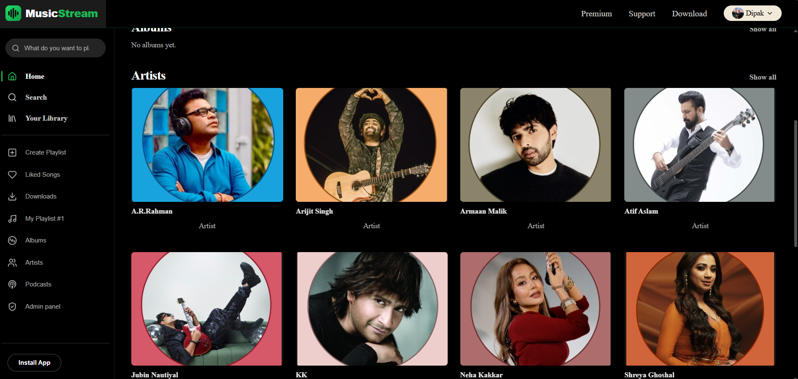
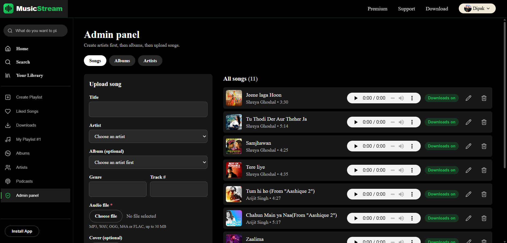
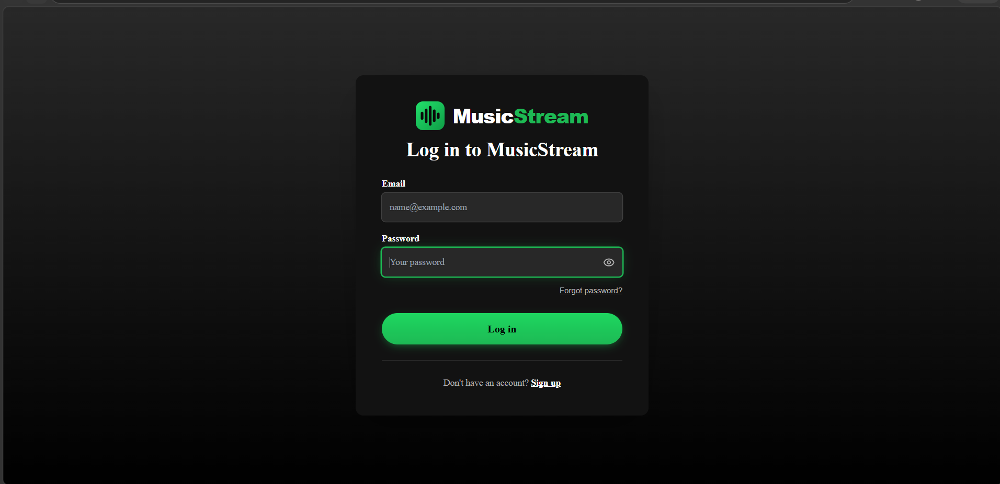

# MusicStream

**A full-stack music streaming web app built with the MERN stack.** Browse and search a music library, build playlists, like songs, and keep listening while you move around the app. Download songs to listen offline, and install it on your phone or computer like a native app.


**Live demo:** https://musicstream-jet.vercel.app/


| Home | Admin | Login |
| --- | --- | --- |
|  |  |  |


## What you can do

**Listen**
- A persistent player that keeps playing while you navigate: play/pause, next/previous, seek, volume, shuffle, repeat and a reorderable queue
- Full-screen player and mini player on phones, with lock-screen and media-key controls
- A player bar that takes its colour from the album art

**Discover**
- Browse songs, albums and artists with cover art and metadata
- Debounced search across songs, artists and albums, with a top result, recent searches and genre tiles

**Your library**
- Playlists: create, rename, delete, add and remove songs
- Liked Songs, with an instant heart toggle everywhere

**Offline**
- **Download in app:** songs are stored in the browser so they play with no internet
- **Save to device:** download audio files to the phone or computer
- Works for single songs, albums, playlists and Liked Songs; admins control which songs can be downloaded

**Accounts and security**
- Sign-up with a 6-digit email verification code, plus password reset by code
- Cookie-based sessions (JWT in an httpOnly cookie), profile editing with a photo upload

**Admin panel**
- Upload songs (audio and cover), create, edit and delete artists, albums and songs, and switch downloads on or off per song

**Installable (PWA)**
- Add it to the home screen on Android, iPhone and desktop; opens in its own window and works offline for downloaded songs

## Tech stack

| Layer | Technology |
| --- | --- |
| Frontend | React 18 (Vite), React Router, Tailwind CSS, Zustand |
| Backend | Node.js, Express 4, Mongoose |
| Database | MongoDB Atlas |
| File storage | Cloudinary (audio and images) |
| Auth | JWT in an httpOnly cookie, bcryptjs, email one-time codes |
| Validation and security | Zod, helmet, cors, express-rate-limit |
| Email | Brevo (also supports Resend and SMTP) |
| Hosting | Vercel (frontend), Render (API) |

## How it works

```
Browser (React single-page app, installable PWA)
   │   every request goes to /api/... on the same site
   ▼
Vercel ── forwards /api/* ──▶ Render (Express API) ──▶ MongoDB Atlas
                                  ├──▶ Cloudinary (audio and images)
                                  └──▶ Brevo (verification and reset emails)
```

Vercel forwards `/api` to the backend so the login cookie is first-party, which keeps login working in Safari and in the installed app. Design decisions, the security model and trade-offs are explained in [docs/ARCHITECTURE.md](docs/ARCHITECTURE.md).

## Run it locally

**You need:** Node.js 18 or newer, a free [MongoDB Atlas](https://www.mongodb.com/atlas) cluster and a free [Cloudinary](https://cloudinary.com) account.

```bash
git clone https://github.com/YOUR-USERNAME/musicstream.git
cd musicstream
npm install                 # installs the dev runner
npm run install:all         # installs server and client dependencies
cp server/.env.example server/.env    # Windows: copy server\.env.example server\.env
# fill in server/.env (see below), then:
npm run dev                 # API on :5000, app on http://localhost:5173
```

The main settings in `server/.env`:

| Variable | Purpose |
| --- | --- |
| `MONGODB_URI` | Atlas connection string, including the database name |
| `JWT_SECRET` | 32+ random characters |
| `CLOUDINARY_CLOUD_NAME`, `CLOUDINARY_API_KEY`, `CLOUDINARY_API_SECRET` | File uploads |
| `EMAIL_PROVIDER` | Leave as `console` locally: verification codes print in the server terminal, no email account needed |
| `CLIENT_URL` | Frontend address (default `http://localhost:5173`) |

Every variable is listed in `server/.env.example`.

**Become an admin:** sign up in the app, then run `npm run make-admin -- you@example.com` inside `server/`.

**Add demo music:** copy `server/seed/tracks.example.json` to `server/seed/tracks.json`, edit it, and run `npm run seed` inside `server/`.

## Deployment

The app is deployed with the frontend on Vercel and the API on Render. Step-by-step instructions, the email setup, production notes and a troubleshooting table are in [docs/DEPLOYMENT.md](docs/DEPLOYMENT.md).

## Project structure

```
musicstream/
├── render.yaml                 Render blueprint (API)
├── docs/                       Architecture and deployment guides
├── server/
│   ├── scripts/                makeAdmin.js, seed.js
│   ├── seed/                   Example seed data
│   └── src/
│       ├── config/             Validated environment, database, Cloudinary
│       ├── controllers/  routes/  models/  validators/
│       ├── middleware/         auth, csrf, sanitize, upload, rate limiters, error handler
│       └── utils/              errors, one-time codes, mailer, uploads
└── client/
    ├── vercel.json             SPA routing, API forwarding, headers
    ├── public/                 Manifest, service worker, offline page, icons
    └── src/
        ├── components/  pages/  hooks/  store/  lib/
```

## Security

Passwords are hashed with bcrypt and sessions use httpOnly cookies. State-changing requests are protected against CSRF (origin allow-list plus a required header), all input is validated with Zod, and sign-in, one-time codes, search, uploads and downloads are rate-limited. Verification codes are stored only as keyed hashes, expire after 10 minutes, and are burned after 5 wrong attempts. The full list is in [docs/ARCHITECTURE.md](docs/ARCHITECTURE.md#security-summary).

## Known limitations

- Search uses regular-expression matching, which suits thousands of songs; very large libraries would need a search engine such as Atlas Search.
- Song files are public Cloudinary links, so the "downloads allowed" setting controls the app's buttons rather than locking the files.
- Cover art is not stored for offline use, and browsers may clear stored downloads.
- The API runs on a free plan that sleeps when idle, so the first request after a quiet period can take up to a minute.
- There are no automated tests yet.

## About this project

I built MusicStream to practise full-stack development end to end: authentication, file uploads, a persistent audio player, search, offline support, security and deployment.

I built it with the help of an AI assistant (Claude), which wrote much of the code from my requirements and design references. I chose the features and the look, set up and configured MongoDB Atlas, Cloudinary and Brevo, deployed the API on Render and the client on Vercel, tested the features, and fixed problems that came up along the way, such as replacing the native `bcrypt` module with `bcryptjs` when it failed to load on Node 24.

## Author

**Dipak Hore**
[GitHub]https://github.com/dipakhore979 · [LinkedIn]https://www.linkedin.com/in/dipak-hore

Released under the [MIT License](LICENSE).

## Credits

Spotify is a trademark of Spotify AB; this project is not affiliated with it. Only use music you have the right to host, and check each track's licence ([Pixabay Music](https://pixabay.com/music/) and the [Free Music Archive](https://freemusicarchive.org/) are good sources).
